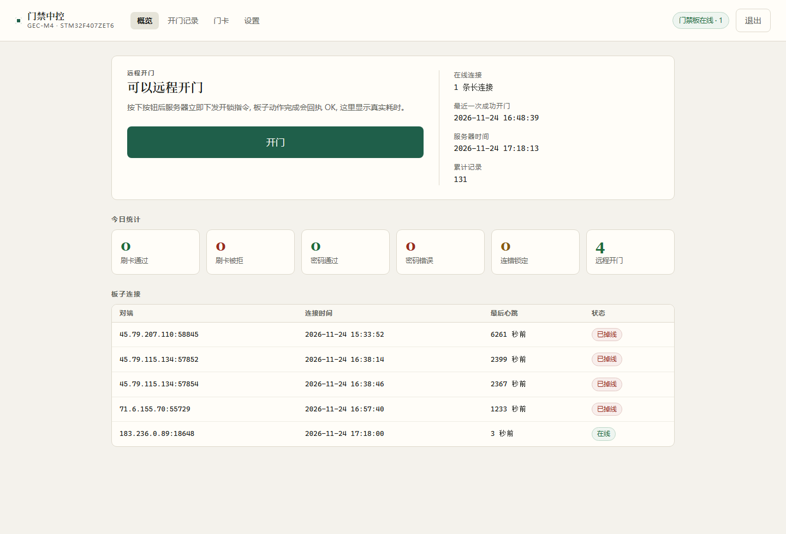
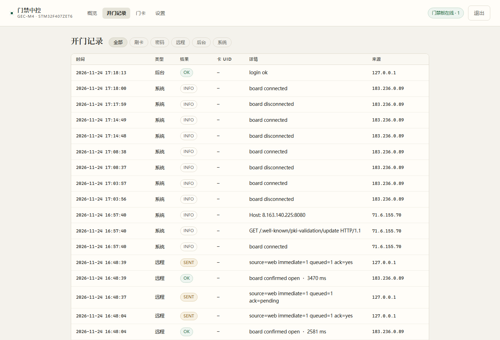
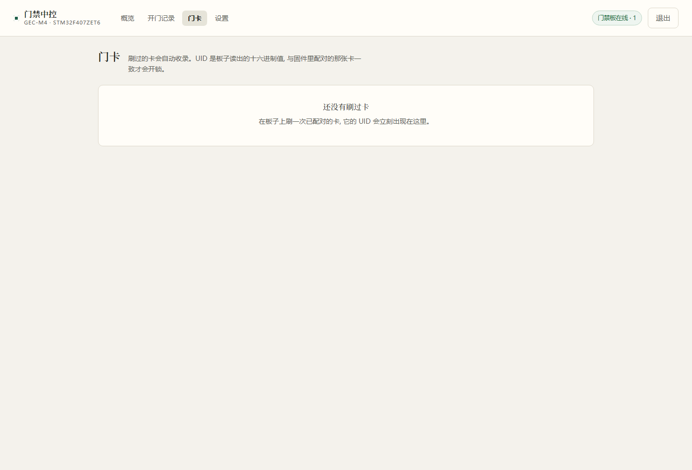
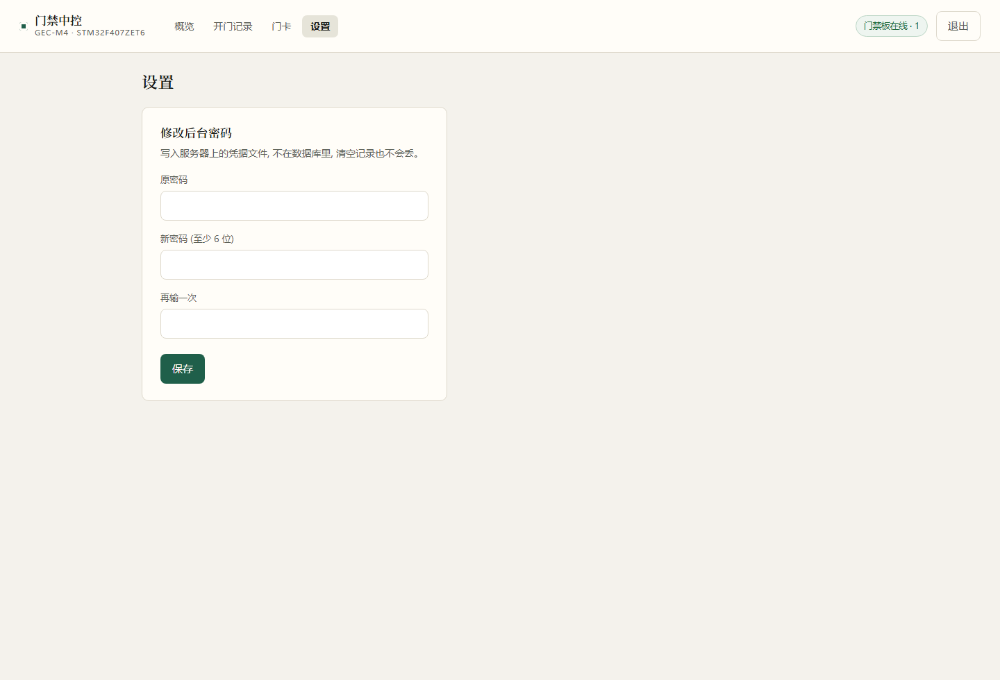
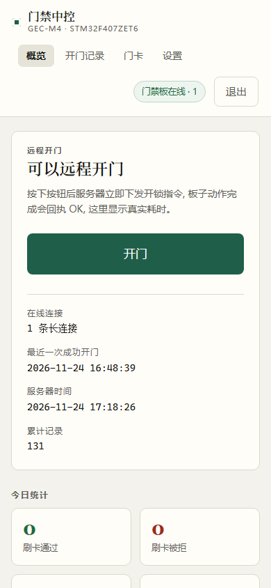

# GEC-M4 智能门禁系统

基于粤嵌 GEC-M4 黄色开发板和 STM32F407ZET6 的嵌入式门禁示例工程。系统集成密码开门、RC522 刷卡、4x4 薄膜键盘、SSD1306 OLED，以及 HC-SR04 超声波靠近检测和低功耗门控。

当前仓库发布版本为 `alpha`，固件源代码位于 `AccessControl/`。

## 功能

- 4x4 薄膜键盘输入密码，支持数字 `0-9` 和字母 `A-D`。
- 支持数字与字母组合密码，例如 `1A2B`。
- `*` 为清除/取消功能键，`#` 为确认功能键；特殊符号不会写入密码。
- 空输入按 `#` 进入改密流程。
- RC522 刷卡开门，首次刷卡可自动配卡。
- SSD1306 128x64 软件 SPI OLED 显示。
- 上电后播放低音量提示音。
- HC-SR04 检测距离小于 `0.5 m` 时点亮 OLED。
- 连续约 `1.2 s` 距离大于 `0.5 m` 后关闭 OLED，并执行 `WFI` 睡眠等待。
- 任意键可唤醒屏幕，并保持一段时间方便操作。
- 距离页显示实时距离和 Echo 诊断信息。
- 开机自检：上电后检测 HC-SR04 与 RC522 是否在位，缺失时首页直接显示 `!(NO HC-SR04)!` 或 `!(NO RC522)!`，模块插回后自动恢复。

## 开机自检

自检只覆盖「软件能电气回读」的模块：没插上就能立刻报出来，不用等到功能失效才发现。

| 模块 | 在位判定方式 | 缺失时报错 |
|---|---|---|
| HC-SR04 超声波 | 回波线空闲时由模块推挽拉低。连续 3 次（约 0.9 s）拿不到有效回波时，临时把 Echo 切成上拉输入读一次电平：读低=线被模块拉着=在位，读高=线浮空=缺失 | `!(NO HC-SR04)!` |
| RC522 读卡器 | 读 `VersionReg`，得到 `0x00` 或 `0xFF` 说明 SPI 上没有器件应答 | `!(NO RC522)!` |
| 4x4 薄膜键盘 | 无电气回读通道（按下只是两根线短接），不参与自检 | — |
| 板载蜂鸣器 / OLED | 只有写通道，不参与自检 | — |

行为约定：

- 报错写在**首页**，优先级高于密码页，密码页被顶下去。
- 每条报错只占一行，格式固定为 `!(具体器件)!`，全大写 ASCII，括号内不超过 14 个字符（128x64 面板一行最多 16 个 8x16 字符）。
- 多个模块同时缺失时，这一行每 `2 s` 轮换一次，保证每个缺失器件都能被看到。
- 故障期间屏幕不熄屏，报错留在屏上。
- 按任意键给出 `6 s` 保持期，保持期内仍显示密码页（保证模块坏了还能用密码进门），之后故障页自动顶回。
- 在位巡检在**运行期持续进行**，不需要按 RESET：HC-SR04 靠连续 3 次无回波后的电平探测，RC522 每 `1 s` 回读一次 `VersionReg`。运行中拔掉任一模块，约 `1 s` 内首页就会报出对应缺失；插回后同样自动恢复。

## 远端开门与门禁中控

固件只做执行器：ESP8266 与服务器保持一条 TCP 长连接，上行 `PING`、`CARD,<UID>,OK|DENY`、`PWD,OK|DENY|LOCK`，收到下行 `OPEN` 后开锁并回 `OK`。服务器端软件位于 [`tools/doorcenter/`](tools/doorcenter/)，提供网页后台，手机浏览器可直接远程开门并查看全部记录；协议与早期 v4 脚本逐字节兼容，**固件无需改动**。

| 能力 | 说明 |
|---|---|
| 远程开门 | 后台首页按钮下发 `OPEN`，板子动作完成后回执 `OK`，记录真实开锁耗时（实测约 2.5 s） |
| 刷卡记录 | `CARD,<UID>,OK/DENY` 落库，UID 自动收录到门卡台账，可加备注、启停、删除 |
| 密码记录 | `PWD,OK|DENY|LOCK` 落库（只记验证结果，不上传用户输入的明文密码） |
| 时间日期 | 所有事件按 `Asia/Shanghai` 写库，含来源 IP 与毫秒耗时 |
| 常驻方式 | systemd 服务，开机自启、崩溃自动拉起 |

### 关键界面

全部截图取自真实部署实例，非设计稿。

**概览：远程开门与板子状态** —— 顶部胶囊显示「门禁板在线 · N」或「门禁板离线」，判定依据是最近 90 秒内是否收到上行心跳（板子每 10 秒一条 `PING`），反映链路真实状态而非进程存活；离线时按钮直接置灰，不会伪造成功。



**开门记录** —— 一行一条，列为时间 / 类型 / 结果 / 卡 UID / 详情 / 来源，可按刷卡、密码、远程、后台、系统筛选；远程开门会先记 `SENT`，板子回执后另记 `OK` 与毫秒耗时。



**门卡** —— 刷过的卡自动收录，不需要手工录入 UID；备注落库持久保存，停用与删除只影响后台台账，不改动固件里已配对的卡。



**设置：修改后台密码** —— 需原密码与新密码两次输入，新密码至少 6 位，改成功后所有已有会话立即失效。



**手机视口（390×844）** —— 同一后台在手机上顶栏换行、事实区改为下方堆叠、表格横向滚动，远程开门按钮在首屏可见。



### 后台密码的存放方式

后台密码不存数据库，而是独立凭据文件（`pbkdf2-hmac-sha256`，20 万轮，只存摘要与盐，文件权限 600）。因此清库、换库、重新部署、服务重启都**不会**把密码重置回初始值，只有显式执行 `--set-password` 才会改。

### 部署

```sh
# 在服务器上（安装包已解开）
sudo sh deploy/install.sh

# 或在本机一键发布：打包 + 上传 + 安装 + 自检
sh deploy/release.sh --open-test
```

`install.sh` 幂等：建服务账号与目录、装 systemd 开机自启、配置 nginx 子路径反代（校验失败自动回滚）、清掉抢占板子端口的旧进程；后台端口若被无关进程长期占用，会自动顺延并持久记录，避免重装漂移。

细节见 [`tools/doorcenter/README.md`](tools/doorcenter/README.md) 与 [`tools/doorcenter/docs/platform.md`](tools/doorcenter/docs/platform.md)。

## 目录

```text
AccessControl/
  Core/                 应用代码和外设驱动
  Drivers/              STM32F4 HAL 和 CMSIS
  MDK-ARM/              Keil MDK 工程
  tools/                OLED 字库相关工具
```

## 硬件接线

| 模块 | 接线 | 说明 |
|---|---|---|
| HC-SR04 Trig | `PE12`，开发板丝印 `D9` | 触发输出 |
| HC-SR04 Echo | `PE14`，开发板丝印 `D11` | 回波输入 |
| HC-SR04 VCC | `5V` | 必须供电 |
| HC-SR04 GND | `GND` | 与开发板共地 |
| OLED SCK | `PD7` | 软件 SPI 时钟 |
| OLED SDA | `PC6` | 软件 SPI 数据 |
| OLED CS | `PD6` | 片选 |
| OLED DC | `PB7` | 数据/命令选择 |
| OLED RES | `PA4` | 复位 |
| OLED VCC | `3.3V` | 不接 5V |
| RC522 SCK | `PG12` | 软件 SPI |
| RC522 MISO | `PD5` | 输入上拉 |
| RC522 MOSI | `PD4` | 软件 SPI |
| RC522 RST | `PE10` | 复位 |
| RC522 CS | `PF12` | 片选 |

4x4 薄膜键盘使用以下 8 根线：

```text
PG15 / PC7 / PC9 / PG9 / PB6 / PE6 / PA8 / PC8
```

键盘不是按常见的“前四根行线、后四根列线”排列。当前实测矩阵为：

```text
1/2/3/A：{0,6} {0,5} {0,7} {0,3}
4/5/6/B：{1,6} {1,5} {1,7} {1,3}
7/8/9/C：{2,6} {2,5} {2,7} {2,3}
*/0/#/D：{4,6} {4,5} {4,7} {4,3}
```

## 构建

工程使用 Keil MDK uVision 5.14 和 ARMCC5。打开以下工程文件：

```text
AccessControl/MDK-ARM/AccessControl.uvprojx
```

Keil 命令行全量构建时，将以下占位路径替换成本机的 uVision 和仓库路径：

```powershell
$uv4 = "<Keil MDK 安装目录>\UV4\UV4.exe"
$project = "<仓库目录>\AccessControl\MDK-ARM\AccessControl.uvprojx"
Start-Process -FilePath $uv4 -ArgumentList ('-r "' + $project + '" -j0') -Wait -PassThru
```

构建产物位于：

```text
AccessControl/MDK-ARM/Objects/AccessControl.hex
```

当前 alpha 版本已在本机实测构建通过，结果为 `0 Error(s), 0 Warning(s)`。

## 烧录

使用 J-Link 的 SWD 接口烧录，不能使用 JTAG。烧录固件时不要无条件执行全片擦除，因为门卡、密码和键盘表分别保存在 Flash 扇区 5、6 和 7 尾部。

推荐使用只加载 HEX 覆盖程序区的方式：

```text
loadfile AccessControl.hex
r
g
qc
```

J-Link 返回的校验结果以 `O.K.` 为准。烧录后建议进入距离页，检查距离值和底部 `W/H` 诊断行。

## 持久化数据

| 内容 | 地址/区域 | 说明 |
|---|---|---|
| 门卡 UID | `0x08020000`，扇区 5 | 首卡自动配卡 |
| 密码 | `0x08040000`，扇区 6 | 默认密码为 `1234` |
| 键盘线对表 | `0x0807C000`，扇区 7 尾部 | 当前固件使用内置实测表 |

## 当前验证状态

- HC-SR04 实测回波已经进入 `PE14`，距离测量正常。
- 距离约 `5 cm` 时屏幕保持点亮。
- 距离约 `67 cm` 持续超过门控时间后，`g_disp_on=0`，程序进入 `HAL_PWR_EnterSLEEPMode`。
- 数字和 `A-D` 字母可以组合输入密码。
- `*`、`#` 保持功能键语义，不作为密码字符。
- 开机自检：拔掉 HC-SR04 时首页显示 `!(NO HC-SR04)!`，拔掉 RC522 时显示 `!(NO RC522)!`；两者都拔时每 2 s 轮换一行；插回后自动恢复密码页。

仓库内容仅包含门禁固件、服务器端门禁中控（`tools/doorcenter/`，含界面截图）、构建依赖、第三方许可证和本代码说明。内部进度与排错文档不随仓库发布。

## 版本

当前发布：`alpha`

GitHub 仓库：<https://github.com/cl-ly/gec-m4-access-control>
