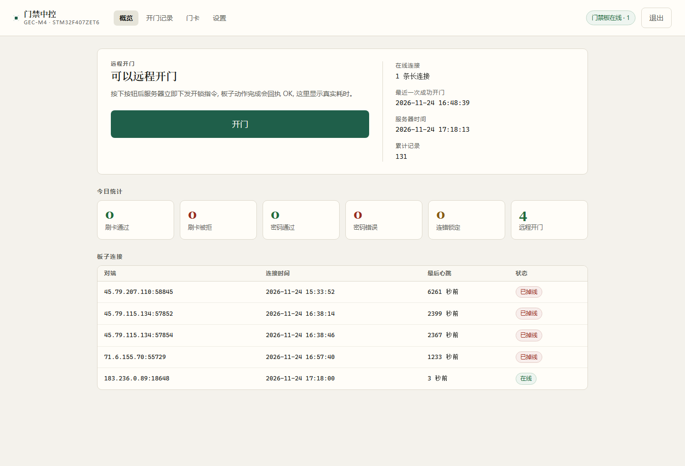
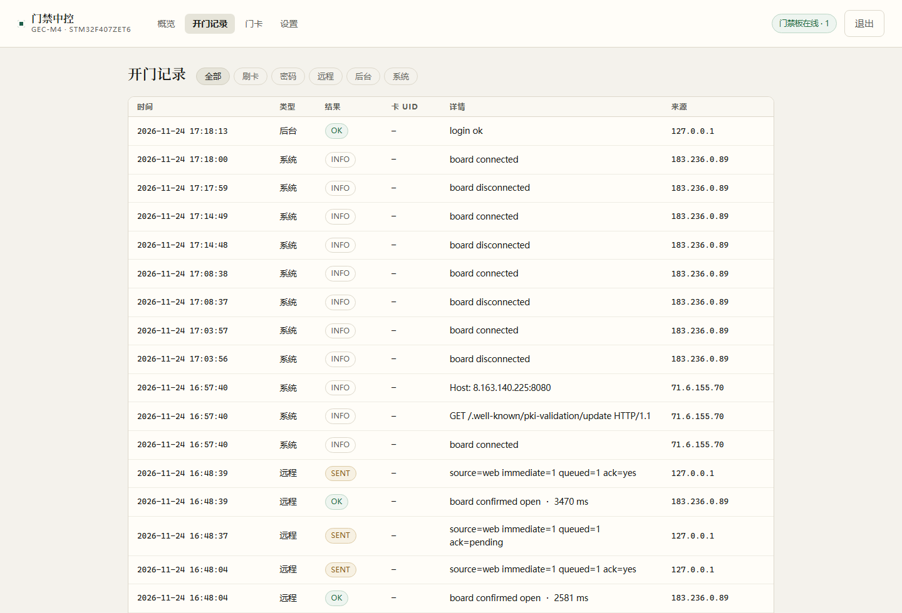
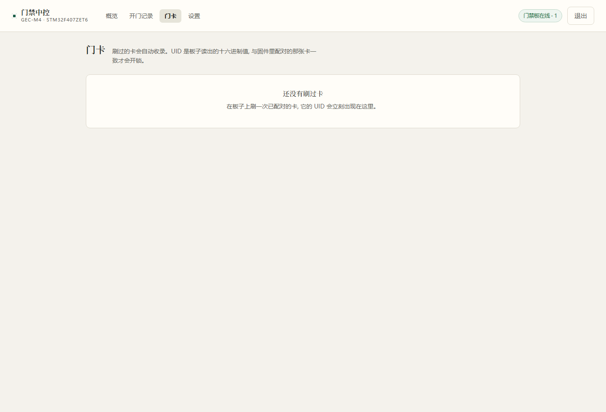
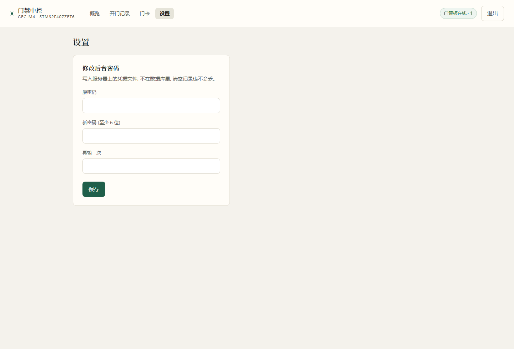
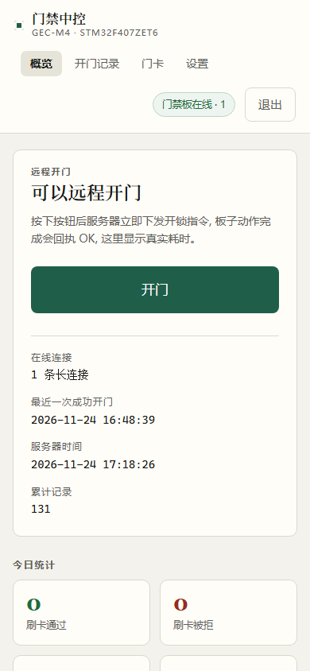

# 云后台关键界面

门禁中控的手机端与桌面端共用同一套页面，入口为 `http://<服务器IP>/door/`，由 nginx 反代到本机 `127.0.0.1:8081`。以下截图取自部署在真实服务器上的实例，非设计稿。

## 1. 概览：远程开门与环境状态



页面第一屏只回答两个问题：现在能不能开门、板子在不在。

- 顶部胶囊直接显示「门禁板在线 · N」或「门禁板离线」。判定依据是最近 90 秒内是否有上行数据（板子每 10 秒一条 `PING`），所以它反映的是链路真实状态，不是进程是否存活。
- 主标题随状态改写。在线时是「可以远程开门」，离线时是「门禁板未连接」，并把排查方向写在下面一行，而不是让人对着一个灰按钮猜。
- 离线时按钮直接置灰，点击不会伪造成功；在线时点击立即下发，回执与真实开锁耗时写进开门记录。
- 右侧四格事实区：在线连接数、最近一次成功开门时间、服务器时间、累计记录数。
- 下方是今日统计与板子连接表（对端地址、建立时间、最后心跳、在线/已掉线）。

## 2. 开门记录



所有事件落 SQLite，时间戳统一按 `Asia/Shanghai` 写入，一行一条：

| 列 | 含义 |
|---|---|
| 时间 | `YYYY-MM-DD HH:MM:SS`，服务器本地时间 |
| 类型 | 刷卡 / 密码 / 远程 / 后台 / 系统 |
| 结果 | `OK`、`DENY`、`LOCK`、`SENT`、`FAIL`、`INFO`，按语义着色 |
| 卡 UID | 刷卡事件为板子读出的十六进制 UID，其余为空 |
| 详情 | 远程开门记下发目标数与回执状态；板子回执后另记一条 `board confirmed open` 与毫秒耗时 |
| 来源 | 事件来源 IP：板子出口 IP 或后台访问者 IP |

顶部可按类型筛选（全部 / 刷卡 / 密码 / 远程 / 后台 / 系统），切换时先出骨架屏再填数据。

## 3. 门卡



刷过的卡会自动出现在这里，不需要手工录入：

- `UID` 为板子读到的十六进制值，与固件里配对的那张卡一致才会开锁。
- 备注可自由填写（例如「大门主卡」），落库持久保存。
- 可停用或删除某条记录；删除只影响后台台账，不改动固件里已配对的卡——页面上的提示写明了这一点，避免误以为能远程撤权。
- 显示最近一次出现时间，便于发现长期未使用的卡。

## 4. 设置：修改后台密码



- 需要原密码与新密码两次输入，前端先校验两次是否一致，后端再校验原密码。
- 新密码至少 6 位；改成功后所有已有会话立即失效，强制用新密码重新登录。
- 密码存在独立的凭据文件 `/var/lib/doorcenter/doorcenter-auth.json`（`pbkdf2-hmac-sha256`，20 万轮，只存摘要与盐，文件权限 600），**不进数据库**。因此清库、换库、重装、重启都不会把密码重置回初始值，只有显式执行 `--set-password` 才会改。

## 5. 手机视口



同一后台在 390×844 视口下的布局：顶栏换行、事实区从右侧栏改为下方堆叠、表格横向滚动。远程开门按钮在首屏可见，适合在门口用手机开锁。

## 状态覆盖

界面按「加载 / 空 / 错误 / 有数据 / 边界」五种状态实现，避免只画有数据的那一种：

| 状态 | 触发条件 | 表现 |
|---|---|---|
| 加载 | 首次进入或切视图 | 骨架屏占位，不闪空白 |
| 空 | 无记录 / 未刷过卡 / 未登录 | 标题 + 一句解释 + 下一步该做什么，不用「暂无数据」打发 |
| 错误 | 服务不可达、板子离线、接口 401 | 顶部胶囊变「服务不可达」或「门禁板离线」，操作按钮同时置灰，并给出可执行的排查方向 |
| 有数据 | 正常 | 表格与统计填满 |
| 边界 | 超长备注、无 UID 事件、多条连接 | 单元格可换行断词，空值统一显示为 `—` |

## 复现方式

截图脚本不依赖手工点击，直接走浏览器 DevTools 协议：

```sh
export DOOR_WEB_PASSWORD='后台密码'
python3 deploy/shots.py --browser-ws ws://127.0.0.1:9333/devtools/browser/<uuid> \
    --base http://<服务器IP> --outdir docs/shots
```

脚本会自动登录、依次切视图、再补一张手机视口。密码只从环境变量读，不写进任何文件。
